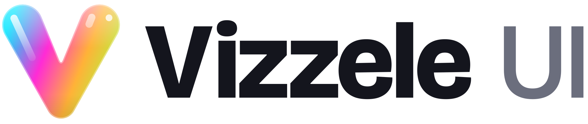
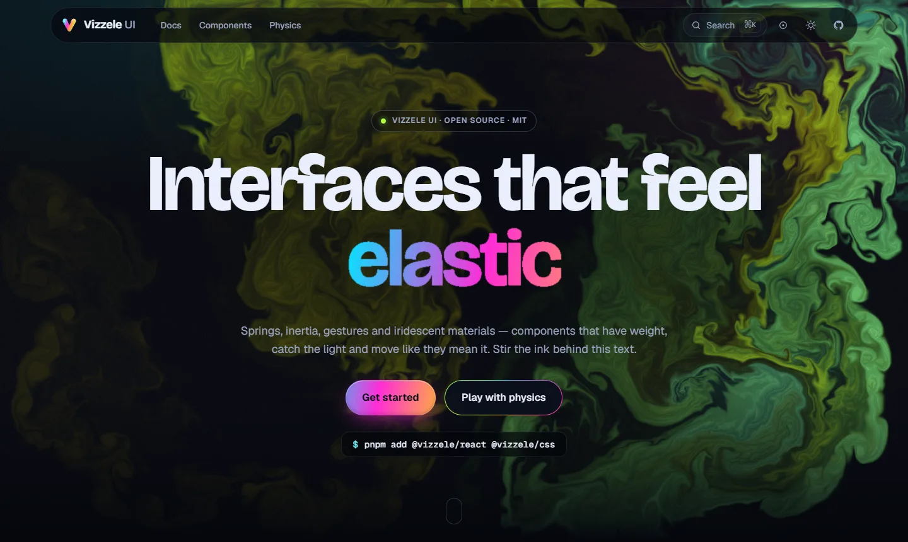
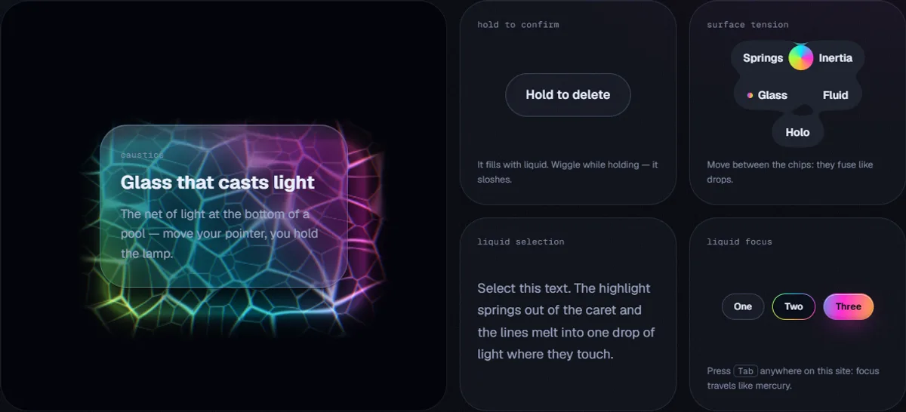
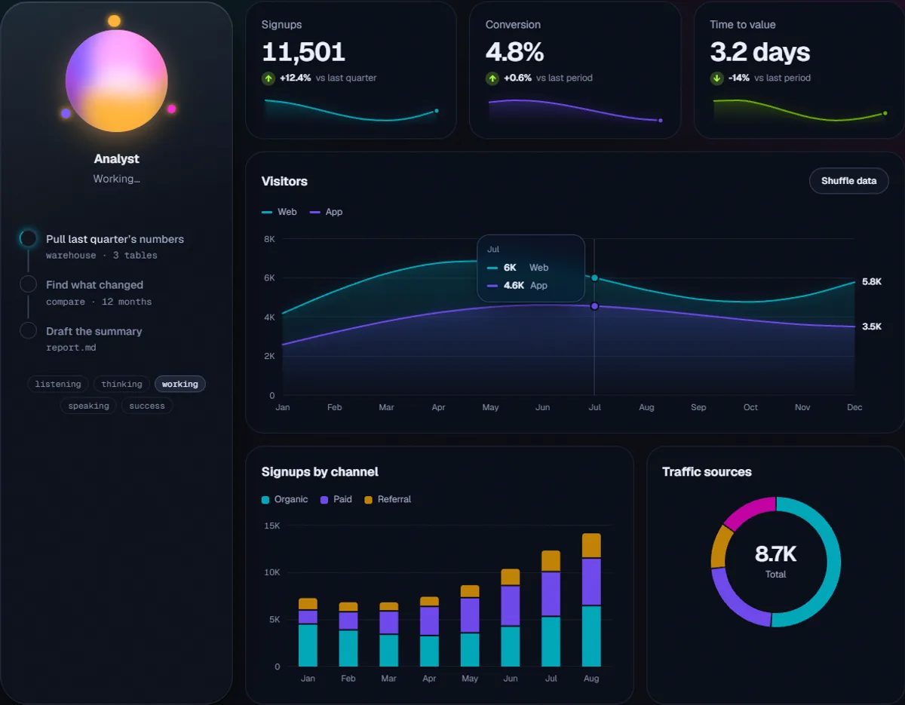
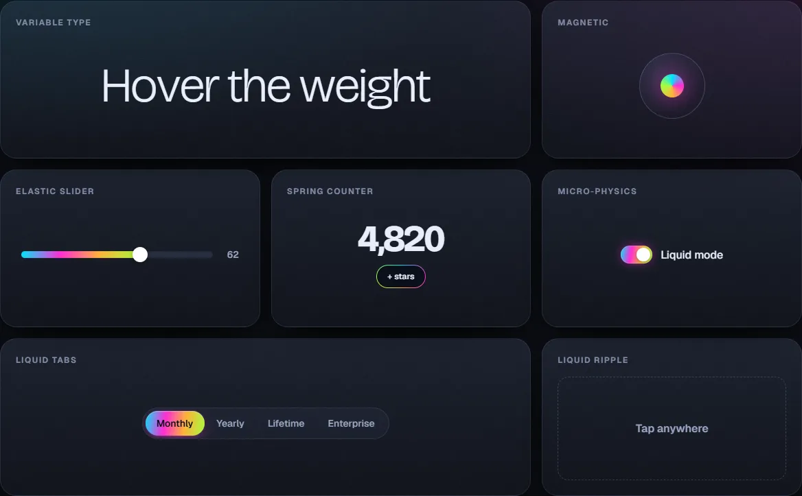
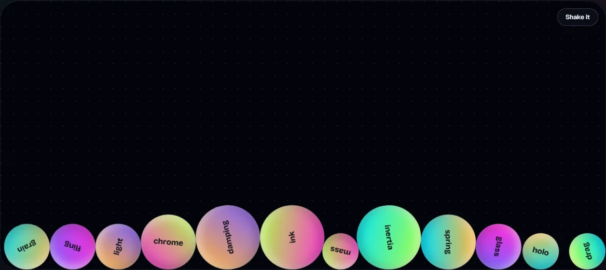
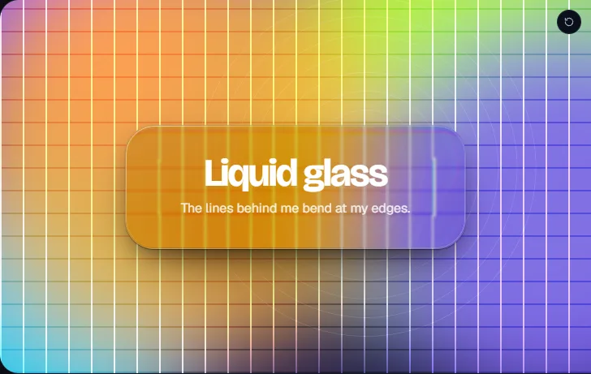
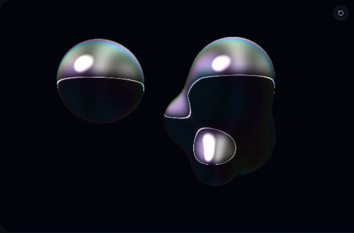

<p align="center">
  <picture>
    <source media="(prefers-color-scheme: dark)" srcset="brand/logo-dark.svg" />
    
  </picture>
</p>

<p align="center">
  <strong>Liquid light for the web.</strong><br />
  Components, gestures and effects with weight, inertia and iridescence — springs instead of easings,
  materials that react to the pointer, and a dignified static version of everything for reduced motion.
</p>

<p align="center">
  <a href="https://github.com/Gxnza48/vizzele-ui/actions"></a>
  
  
  
</p>

<p align="center"><a href="https://vizzele-ui.vercel.app"><strong>Live docs &amp; playground → vizzele-ui.vercel.app</strong></a></p>

[](https://vizzele-ui.vercel.app)

## What's inside

| Package                            | What it is                                                                                                                                      | Size (min + brotli)                                                |
| ---------------------------------- | ----------------------------------------------------------------------------------------------------------------------------------------------- | ------------------------------------------------------------------ |
| [`@vizzele/core`](packages/core)   | Zero-dependency engine: analytic springs, inertia, drag, physics world, scroll, text effects, `data-vz-*` attributes, WebGL backgrounds (`/gl`) | 22.8 kB all · `Spring` 1.7 kB · `draggable` 4.8 kB · `/gl` 10.5 kB |
| [`@vizzele/react`](packages/react) | 70+ components and hooks built on the core (SSR-safe, `'use client'` ready)                                                                     | 41.2 kB all · `Button` 4.3 kB · `LineChart` 4.5 kB                 |
| [`@vizzele/css`](packages/css)     | Tokens, themes, liquid-light materials and pure-CSS motion utilities                                                                            | 13.3 kB                                                            |

Everything is tree-shakeable — you pay for what you import. Sizes are enforced in CI with `size-limit`.

## The catalog

**Originals — effects that don't exist in any other library**

- **Liquid focus** — one page-wide focus ring that travels between elements like a drop of mercury
- **Liquid selection** — text selection as springy blobs of light that fuse across lines
- **Hold to confirm** — a button that fills with liquid (real wave simulation: it splashes, sloshes and drains)
- **Caustics** — glass that casts the moving net of light you see at the bottom of a pool
- **Surface tension** — items that lean toward the pointer and fuse with their neighbours like drops

[](https://vizzele-ui.vercel.app/docs/liquid-focus)

**Charts** — line & area · bar (grouped / stacked) · donut · sparkline · stat card. Values spring between datasets, a crosshair snaps to the nearest point, arrow keys read every value, and each chart carries a hidden data table. The palette is the brand's hues stepped into a colorblind-safe, contrast-checked band per theme.

**AI** — an agent orb with seven states (idle · listening · thinking · working · speaking · success · error) that reacts to a live voice level, a status line announced to screen readers, and a step-by-step progress timeline.

[](https://vizzele-ui.vercel.app/docs/line-chart)

**Cursor & pointer** — liquid cursor with trail and states · magnetic · spotlight borders · 3D tilt with holographic foil · liquid ripple · particle trail

**Drag & physics** — throwable cards with inertia and rubber-band walls · reorder list · swipe stack · elastic slider · drag-to-dismiss · bottom sheet with snap points · infinite canvas · 2D physics playground

**Backgrounds (WebGL2, hand-written, no three.js)** — fluid simulation stirred by the pointer · iridescent mesh gradient · particle field · raymarched liquid metal · lens-distortion grid · GPU grain

**Text** — scramble/decode · reveal by chars, words or lines · iridescent shimmer · variable-font weight wave · gooey word morph · spring counter

**Scroll** — parallax · horizontal scroll section · sticky stacking cards · reading progress · staggered reveals · optional smooth scroll

**Components** — Select & Dropdown menu with a liquid highlight · Button (liquid · holo · glow) · Card (glass · holo · spotlight) · **liquid glass with real refraction** · Modal that morphs out of its trigger · Tabs with a liquid indicator · macOS-style Dock · Navbar that condenses on scroll · Switch / Checkbox / Radio · Input with a border of light · Tooltip · Popover · Toast · Accordion · draggable Marquee · 3D carousel · liquid image reveal · iridescent Skeleton

<table>
  <tr>
    <td></td>
    <td></td>
  </tr>
  <tr>
    <td></td>
    <td></td>
  </tr>
</table>

## Quick start

### React / Next.js

```bash
pnpm add @vizzele/react @vizzele/css
```

```tsx
import '@vizzele/css';
import { Button, Draggable, Toaster, toast } from '@vizzele/react';
import { FluidBackground } from '@vizzele/react/gl';

export default function Hero() {
  return (
    <section style={{ position: 'relative' }}>
      <FluidBackground />
      <Draggable bounds="parent" rotate={8}>
        <Button variant="liquid" magnetic onClick={() => toast.success('Thrown!')}>
          Throw me
        </Button>
      </Draggable>
      <Toaster />
    </section>
  );
}
```

### Vanilla JS

```ts
import '@vizzele/css';
import { draggable, magnetic, Spring } from '@vizzele/core';

draggable(document.querySelector('.card')!, { bounds: 'parent', snap: { x: [0, 240] } });
magnetic(document.querySelector('.cta')!, { strength: 0.4 });

const x = new Spring({
  stiffness: 260,
  damping: 11,
  onUpdate: (v) => (el.style.translate = `${v}px`),
});
x.set(200);
```

### No build step

```html
<link rel="stylesheet" href="https://unpkg.com/@vizzele/css/dist/vizzele.min.css" />
<script src="https://unpkg.com/@vizzele/core/dist/vizzele.global.js" defer></script>

<button class="vz-button" data-variant="liquid" data-vz-magnetic="strength: 0.4">Hover me</button>
<div class="vz-card vz-holo" data-vz-tilt="max: 14">Holographic</div>
<div class="vz-card" data-vz-drag="bounds: parent; rotate: 8">Throw me</div>
```

## Principles

- **Physics, not keyframes.** Springs are solved in closed form, so motion is exact at 30, 60 or 144 fps. Released objects carry their velocity into an exponential glide that bounces off limits with a spring.
- **One frame loop.** A single shared `requestAnimationFrame` scheduler with read → update → render phases; it sleeps when nothing moves. Off-screen canvases and background tabs pause.
- **Composable transforms.** Several effects can drive the same element (draggable + magnetic + tilt) — each writes its own transform layer and Vizzele composes them once per frame.
- **Accessible by default.** WAI-ARIA patterns (tabs, dialog, switch, slider, carousel), keyboard paths for every gesture (reorder, swipe, drag, sheet), focus traps and return, live announcements. The docs pass axe (WCAG 2.1 AA) with zero violations in both themes.
- **Reduced motion is a first-class design**, not an off switch: springs jump, reveals show, canvases render a still frame, dragging still works without the throw.
- **SSR-safe.** Nothing touches `window` at import time; every component renders in plain Node (tested).

## Theming

Every color, radius, spring and blur is a CSS custom property. Switch with `data-theme="dark" | "light" | "auto"`, or define your own:

```css
[data-theme='ember'] {
  --vz-bg: #0d0806;
  --vz-accent: #ff7a2f;
  --vz-cyan: #ffb238;
  --vz-magenta: #ff3d6e;
}
```

The spring presets are also exported as CSS `linear()` easings generated from the real physics: `transition: transform var(--vz-spring-jelly-duration) var(--vz-spring-jelly);`

## Development

```bash
pnpm install
pnpm dev          # docs at http://localhost:3100 + package builds
pnpm test         # vitest (core physics, drag, scheduler; React components + SSR)
pnpm lint && pnpm typecheck && pnpm build && pnpm size
pnpm changeset    # describe a change for the next release
```

Monorepo: pnpm workspaces + Turborepo · TypeScript strict · tsup (ESM + CJS + types) · Vitest · ESLint + Prettier · Changesets · GitHub Actions.

## License

[MIT](LICENSE)
